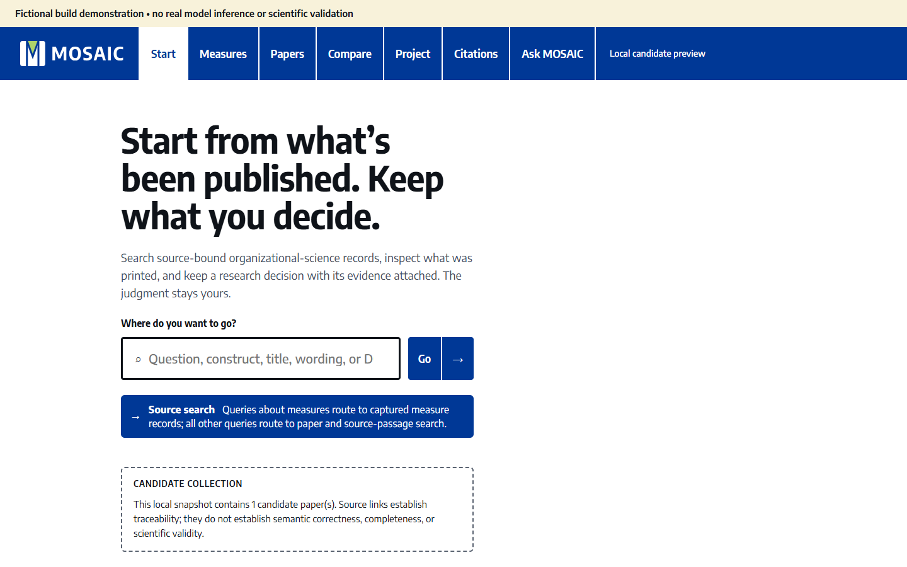
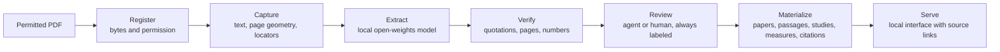
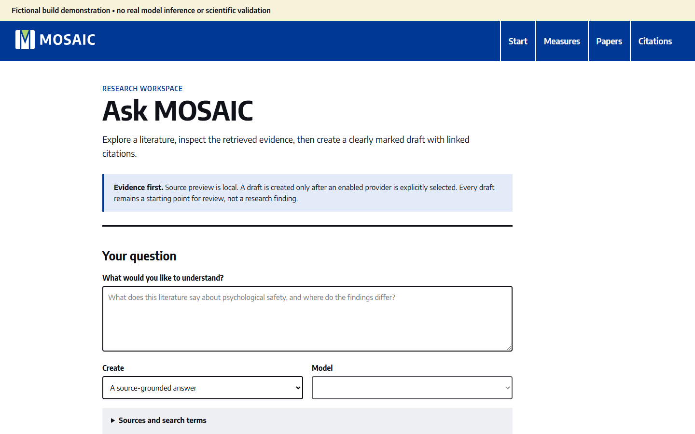

# MOSAIC

**Source-bound infrastructure for inspectable literature synthesis.**
Anonymous review copy for a stage-one submission to *Organization Science*
(Special Issue: AI-Enabled Frontiers).

Review copy · CPython 3.12 · Windows route documented, Linux route container-tested · no API keys or model weights needed

MOSAIC turns PDFs that a researcher is permitted to use into searchable papers,
passages, studies, measures and citations, and every record links back to the
page it came from. A local open-weights model proposes candidate evidence, code
checks each proposal against the source, and review and display decisions are
recorded separately. A reader can always see what a record rests on and what is
still unresolved.



*Screenshot of the fictional build in this repository. It contains no real articles.*

## Contents

- [Try it with one command](#try-it-with-one-command)
- [How it works](#how-it-works)
- [A ten-minute review path](#a-ten-minute-review-path)
- [What this repository shows, and what it doesn't](#what-this-repository-shows-and-what-it-doesnt)
- [What has been tested](#what-has-been-tested)
- [Integrity](#integrity)
- [Terms](#terms)

## Try it with one command

Reference environment: Windows x86_64 with CPython 3.12. From the `build/`
directory:

```powershell
py -3.12 start.py
```

The launcher creates `.venv-public`, installs hash-locked dependencies from
PyPI, checks the installed inventory, and runs a generated fictional PDF through
native capture, the extraction driver (with predetermined fictional responses),
materialization and indexing. It then serves the interface at the loopback
address it prints. Add `--no-serve` to run the pipeline without the interface.

The route downloads no model weights, calls no model provider and needs no API
key. Use a fresh directory: the launcher refuses an environment that already
contains other packages or versions. An offline install from a locked wheelhouse
is described in [the quickstart](build/PUBLIC_BUILD_QUICKSTART.md).

## How it works



In words: registration binds each PDF to its exact bytes and a permission
declaration. Capture keeps the text, page geometry and locators without
rewriting them. A local open-weights model proposes candidate claims,
statistics, study designs and measures, each with a literal supporting
quotation. Verification checks hashes, schemas, quotations, page numbers and
offsets, and refuses a quotation it can't find or one that alters a number.
Review records who or what reviewed each item, and agent review stays labeled
as agent review. Materialization builds the reader-facing views without
rerunning extraction, so the interface can change while the evidence underneath
stays fixed.

An optional literature assistant retrieves admitted local passages and attaches
supporting spans before drafting. Drafting is opt-in and goes through a
server-side adapter for a hosted model chosen by the operator; without one,
retrieval and the evidence preview still work locally.



## A ten-minute review path

1. Read [what the build does](build/README.md).
2. Run the command above and open the printed address.
3. Follow one source through every stage in [the build guide](build/BUILD_GUIDE.md).
4. Check the boundaries: [public archive versus private demonstration](build/FEATURE_SCOPE.md),
   [the optional literature assistant](build/PUBLIC_LITERATURE.md) and
   [the advisory classifier sidecar](build/PUBLIC_JEV.md).
5. See exactly what was and wasn't tested in [the validation annex](VALIDATION.json).

The architecture is in [the design specification](build/DESIGN_SPEC.md). The
own-corpus route, with its review requirements, is in
[the corpus workflow](build/CORPUS_WORKFLOW.md).

## What this repository shows, and what it doesn't

| | This repository | Private installation described in the technical addendum |
| --- | --- | --- |
| Sources | One generated fictional PDF | Permitted published articles (not shared) |
| Extraction | Driver replays predetermined fictional responses | Records from earlier private processing runs and recovered project data |
| Scale | One fictional paper | 4,343 reviewed article identities and 20,439 measure groups |
| Accuracy on real articles | Not measured | Not yet independently measured |

The repository contains no published articles, private corpus data, source
quotations, model weights or credentials. Both screenshots show the fictional
build.

## What has been tested

- The documented Windows route passed from a bare CPython 3.12 installation
  with a newly created environment.
- The same archive passed a CPU-only Linux fictional route in a pinned container.
- The preserved v39 export passed 284 exported tests, and 12 focused checks
  passed for the v40 change. A full v40 exported-suite run was not made.
- The source repository's full gate passed (4,906 passed, 3 skipped, 3 expected
  failures), as did working-tree and full-history secret scans.
- A controlled GPU run loaded the open-weights model and returned a readiness
  response, but made no extraction request, so complete real-model extraction
  is not yet established.
- Forty-one historical checks remain pending because their original inputs are
  unavailable.

None of these software checks measures extraction accuracy on real articles.

## Integrity

Everything under `build/` is byte-identical to the frozen v40 archive and is
bound by `build/EXPORT-MANIFEST.json`. This repository stores files without
line-ending conversion (see `.gitattributes`).

- Core archive SHA-256: `f8bb7e1ada4e42fe2a7e1746861ad48c3b538f92cf0ea4faf253dd0ac26c5bad`
- Core manifest SHA-256: `832a9109eee31858fc440bf76ccd625c976c4b1d78ff9000212d939d29393fed`
- Validation annex SHA-256: `ecf8acaf4fd6d2b7123d743711201f547698976c1f6d84ff351e5e08472b9087`

## Terms

Shared for peer review under [the review terms](REVIEW_TERMS.md). No open-source
license has been selected yet. Third-party packages keep their own licenses; see
[the third-party notices](build/NOTICE.md).
