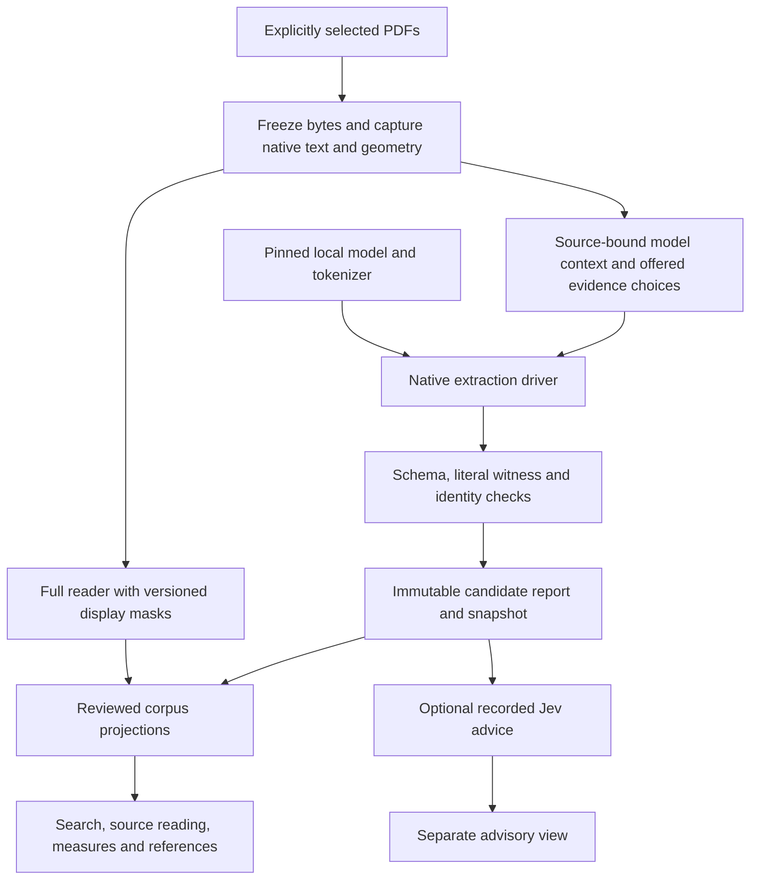

# From selected PDFs to a local research interface

The public corpus route uses the same native extraction driver as the development
system. Every result remains a candidate: a successful build is an engineering
observation, not an accuracy estimate. The Windows fictional demonstration is a
separately tested installation profile. A pinned Linux/GPU installation and actual
model smoke are still required before calling the real-model profile supported.



There is no arrow from advice back into extraction or acceptance. Researchers
can change views while retaining the same source/report evidence.

## 1. Declare the inputs and runtime

Copy `config/mosaic.corpus.example.toml` and list only the PDFs you intend and are
permitted to process. No corpus directory is crawled automatically. Copy
`config/public_model_declaration.example.json` and record the actual immutable model
revision, tokenizer contract, runtime image/wheel identities and declared hardware.
The model directory must be a complete local tree with regular files and no links.
Acquiring those weights and installing the Linux inference server are separate
prerequisites; this command does neither.

```powershell
.venv-public/Scripts/python.exe bootstrap.py inventory-model --model-declaration config/my-model.json --weights-root models/my-model --output config/my-model-manifest.json
```

This inventories every selected local file and computes its size and SHA-256.
Copy the returned `model_files_sha256` into the corpus TOML's `weights_sha256`.
This hash identifies a file tree, rather than a single shard. The inventory verifies
local bytes; upstream origin and the runtime/hardware declarations still need
independent evidence. Keep the manifest outside the model directory.

Copy `config/public_native_driver.example.json`; match its model ID/revision and
served model name to the actual server. Its request, token, article and wall-clock
limits are finite. A separately declared 60-second driver cleanup reserve permits
outcomes to be recorded after the send window closes.

## 2. Capture and prepare without inference

```powershell
.venv-public/Scripts/python.exe bootstrap.py corpus --config config/my-corpus.toml --model-manifest config/my-model-manifest.json --weights-root models/my-model --driver-profile config/my-driver.json
```

The command registers explicit PDFs, freezes their bytes, captures native text and
geometry, produces a full reader, prepares model-eligible source packets, checks
the model/tokenizer and freezes each native program. It makes no model requests
without `--live`. Per-source intake/capture/preparation refusals remain in the build
report. A missing Abstract heading remains a review case; it is not an invented
start. Native OCR is not enabled in this profile.

This preparation route is implemented; it is not a completed own-corpus result.
Its `prepared_only` report has `own_corpus_pipeline_ready: false` and
`real_model_inference_run: false`. Keep that report. A later manual materialization
needs a fresh output path; it must not overwrite an earlier view.

## 3. Execute the prepared corpus and inspect it

Run the same command on the machine that hosts the local model server, adding
`--live --serve`. The endpoint must be literal loopback. The adapter checks health
and the declared served model name, records observed client/runtime metadata,
invokes the current extraction driver, preserves all request/outcome records,
creates source-bound snapshots, materializes corpus views and checks their HTTP
readiness. It never falls back to a hosted extraction model.

Successful outputs can be reused only after their bindings and hashes verify.
An unknown or incomplete send stops execution and remains visible. Changing output
directories cannot retry the same prepared program. A new run is a new experiment,
not a way to erase an earlier failed or uncertain outcome.

The command prints the immutable build-report path and serving bundle path. A
completed local exchange does not independently prove which weights the server
loaded, supported GPU compatibility, or scientific accuracy. Keep the separate
Linux model-smoke receipt with the build evidence.

## 4. Review bibliographic and discovery records

Raw captures and complete candidate reports survive independently of clean display
rows. The corpus builder retains review queues for article identity, printed
references and measure candidates. Complete source-bound review records can be
supplied through `--reviews`; they never modify extraction results. Default article
rows require complete title, byline, journal and year. Only complete formatted
references enter the APA list. Measures are ranked by distinct-article frequency.

### Make an explicit identity/APA review

Run the no-`--live` command first. From its capture output, identify the exact
paper directory containing `receipt.json`, `source.pdf`, `native-reader.json`,
`source.json`, `source-binding.json`, and `prepare-upstream-input.json`. The
review helper reads the full native reader, not only model-eligible text.

```powershell
.venv-public\Scripts\python.exe -m mosaic.public_review catalogue `
  --capture-root run/my-corpus-v1/stages/capture/<capture-attempt>/papers/public-<pdf-sha256> `
  --output run/reviews/catalogue-v1.json

.venv-public\Scripts\python.exe -m mosaic.public_review draft `
  --capture-root run/my-corpus-v1/stages/capture/<capture-attempt>/papers/public-<pdf-sha256> `
  --output run/reviews/draft-v1.json
```

The catalogue gives each original `unit_id`, page, global offsets, literal quote,
and quote hash. The draft is valid for `--reviews`, but deliberately has no
identity/APA records and therefore admits nothing to **Papers**.

Make an identity-selection JSON file using the exact catalogue values. Its shape
is shown below; it is an editing guide, not reusable data. Every `value` must be
the literal selected substring, and `start`/`end` are the catalogue's global
offsets. The `year` value is an integer, while the other three values are strings.

Each field must fit one native unit. If the complete title or byline crosses
units, retain it in the review queue. Do not shorten it, concatenate units or
invent offsets. APA author strings also require review against the complete
printed byline; the helper records that attestation but does not verify the
author-name transformation.

```json
{
  "title": {"value":"<printed title>","unit_id":"<unit-id>","start":<start>,"end":<end>},
  "authors": {"value":"<full printed byline>","unit_id":"<unit-id>","start":<start>,"end":<end>},
  "journal": {"value":"<printed journal>","unit_id":"<unit-id>","start":<start>,"end":<end>},
  "year": {"value":2024,"unit_id":"<unit-id>","start":<start>,"end":<end>}
}
```

Write an attestation separately. `human_source_review` means the operator
explicitly attests a human source review. `agent_source_layout_review` means the
operator explicitly attests an agent layout review; it must not be described as a
human or independent review. The helper refuses the weaker caller-only type and
does not determine who reviewed the source.

```json
{"reviewer_type":"human_source_review","version":"my-review-v1"}
```

To add optional APA rendering, supply `authors_apa`, an explicit curated
`title_apa`, and literal supplement selectors named only `volume`, `issue`,
`pages_verbatim`, `article_number`, or `doi`. `title_apa` must have exactly the
same source wording as the reviewed printed title apart from case; it is an
operator's recorded APA capitalization choice, not automatic lowercasing.
For example: `{"authors_apa":["Price, H."],"title_apa":"Coordination routines in fictional teams","supplements":{}}`.
The helper binds APA to the identity byline and wording, but does not decide APA
capitalization semantics or accept a title, author, journal, year, or provenance
override.

```powershell
.venv-public\Scripts\python.exe -m mosaic.public_review finalize `
  --capture-root run/my-corpus-v1/stages/capture/<capture-attempt>/papers/public-<pdf-sha256> `
  --identity run/reviews/identity-v1.json `
  --attestation run/reviews/attestation-v1.json `
  --apa run/reviews/apa-v1.json `
  --output run/reviews/review-v1.json
```

`finalize` computes the witness and receipt hashes, then writes canonical JSON
once. A changed existing output is refused. It also refuses source-PDF drift,
missing/overlapping selectors, nonliteral values, and absent/invalid attestation.
It never discovers bibliographic facts, infers a review, changes extraction, or
establishes scientific validity.

`finalize` produces one immutable paper record. For a corpus with more than one
reviewed paper, finalize each record to a different path, then combine those
records into the one `--reviews` envelope the corpus command accepts:

```powershell
.venv-public\Scripts\python.exe -m mosaic.public_review merge `
  --input run/reviews/review-paper-a-v1.json `
  --input run/reviews/review-paper-b-v1.json `
  --output run/reviews/corpus-reviews-v1.json
```

`merge` only combines immutable records. It refuses an invalid envelope or the
same paper twice; it does not make an unreviewed field admissible. Corpus
materialization rechecks every literal witness and review receipt against the
paper it accompanies.

Identity and APA supplement selectors must use `front_matter` or `body` units.
References, appendices, tables, headings and unknown lanes cannot establish the
containing article's identity. The corpus builder repeats this check for manually
authored files. Eligible lanes do not establish bibliographic meaning on their
own; the source review must still verify each field's role.

Pass the resulting review file only to the corpus command:

```powershell
.venv-public\Scripts\python.exe bootstrap.py corpus --config config/my-corpus.toml `
  --model-manifest config/my-model-manifest.json --weights-root models/my-model `
  --driver-profile config/my-driver.json --reviews run/reviews/corpus-reviews-v1.json --live --serve
```

The implementation and its exported tests define the precise review record
contract. A field's exact presence in a PDF is a literal witness, not proof of its
bibliographic role. Reviewer provenance and the review decision must also be
recorded. A caller declaration must never be described as independent human review.
See `PUBLIC_CORPUS.md` for the schema and `checks/test_public_review.py` plus
`checks/test_public_corpus_pipeline.py` in an export. The repository source paths
are `tests/test_public_review.py` and `tests/test_public_corpus_pipeline.py`.

To rebuild views from existing artifacts, use `bootstrap.py materialize --manifest
config/my-corpus-input.json --output run/my-view-v2 --serve`. The input manifest
binds each capture receipt, report and snapshot by hash. It does not rerun inference.
Use `bootstrap.py serve --bundle run/my-view-v2/bundle.json` to reopen a verified view.

`materialize` uses a different envelope from `--reviews`: it needs a
`mosaic-public-corpus-input/v1` manifest with a nonempty `sources` list. Each
source has project-relative `capture_root` and `capture_receipt_sha256`, plus
`report` and `snapshot` objects with exactly `path` and `sha256`. Optional
`identity_review`, `apa_review`, references, measures, and advisory sidecars sit
inside that source row. Do not pass a standalone review file to `materialize`.
The output directory must be new and absent. Its HTTP readiness receipt is a
loopback mechanical check, not browser validation, verified runtime weights,
complete coverage, rights clearance, or scientific validation.

## 5. Add optional advice after extraction

See `PUBLIC_JEV.md`. An explicit task selects literal spans from a completed public
snapshot and pins the source, task and definitions. A live assessment requires the
operator's gateway key, explicit send action and cumulative budget/ledger. Offline
replay requires a matching recorded advisory sidecar and its hash. Advice does not
alter extraction, display admission, tiers, or scientific acceptance.

## What a reproducible submission must retain

Keep the export manifest, dependency inventory, input/review declarations, model
inventory, frozen programs, append-only ledgers, all refusal outcomes, source-bound
reports, serving manifests and observed validation receipts. Keep software tests,
real-model execution, source-context accuracy review, and rights clearance as
separate evidence. The public package contains infrastructure and fictional
demonstrations; private corpus data and provider responses are not exported.

## What growing a corpus can add

More articles can reveal repeated measures, shared references and connections
between findings that a single article cannot show. Distinct-article counts avoid
inflating frequency when an article repeats a measure. Actual citation edges need
reviewed source and target identities; shared references do not by themselves prove
that two papers agree. Whether scale improves research decisions, discovery or
extraction accuracy is an evaluation question, not a demonstrated result of these
software checks. Report corpus size and coverage alongside uncertainty and withheld
records whenever illustrating the system's value.

The Studies view displays source-bound core candidate inventories with verified
quotation/page links and visible stage availability. A missing inventory is marked
unavailable. Complete wrapper reports remain accessible; their fields are not
silently promoted into the core inventory. Citation discovery explains shared
references and co-citation using reviewed edges only; unresolved strings do not
count as graph connections. These are candidate views, not scientific validation.
